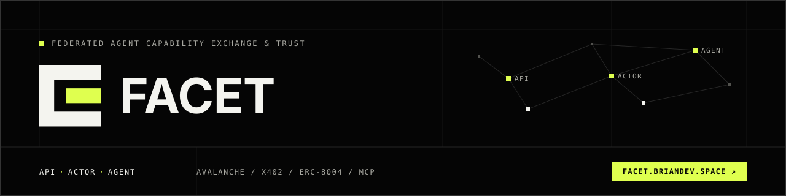

  <a href="https://facet.briandev.space">
    <picture>
      <source media="(prefers-color-scheme: dark)" srcset="./assets/facet-org-banner-dark.svg" />
      <source media="(prefers-color-scheme: light)" srcset="./assets/facet-org-banner-light.svg" />
      
    </picture>
  </a>

  
  
  

## About FACET

**FACET (Federated Agent Capability Exchange & Trust)** is a multi-modal, agent-native capability marketplace and execution protocol on **Avalanche**. It unifies external HTTP **APIs**, sandboxed **Actors**, and autonomous **Agents** (`ERC-8004`) under one shared `FacetManifest` contract—combining JSON Schema validation, **HTTP x402** `fUSD` micropayments, **MCP** discovery, and verifiable on-chain execution receipts.

| Modality | Capability Model |
|---|---|
| **`API`** | Full-HTTP external endpoints (`GET` / `POST` / `PUT` / `PATCH` / `DELETE`) and OpenAPI specs with encrypted upstream credentials and x402 billing. |
| **`ACTOR`** | Single-file ESM JavaScript workloads executed in isolated Docker sandboxes returning structured datasets and cryptographic usage proofs. |
| **`AGENT`** | Autonomous A2A agents anchored to canonical **ERC-8004** on-chain identities on Avalanche with bounded task delegation and escrow settlement. |

## Website

- **Live Platform & Docs:** [`https://facet.briandev.space`](https://facet.briandev.space)

## Founder

**Brian Nguyen** — Founder & CEO of FACET

  
  
  

